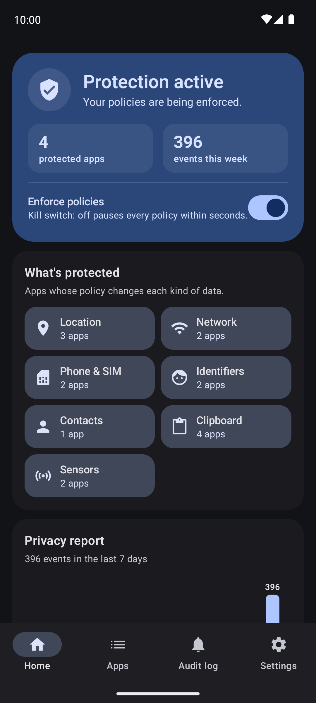
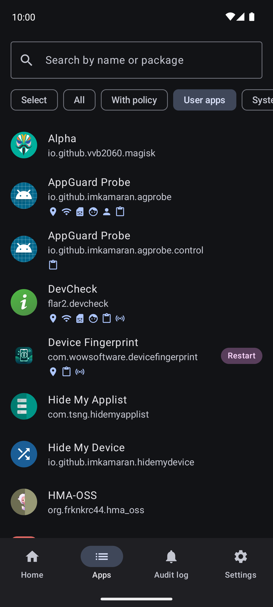
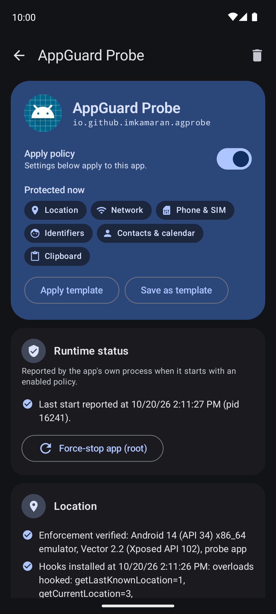
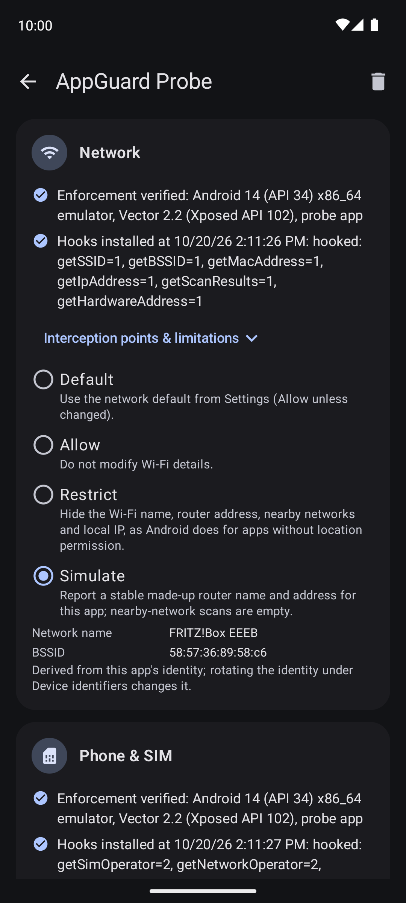
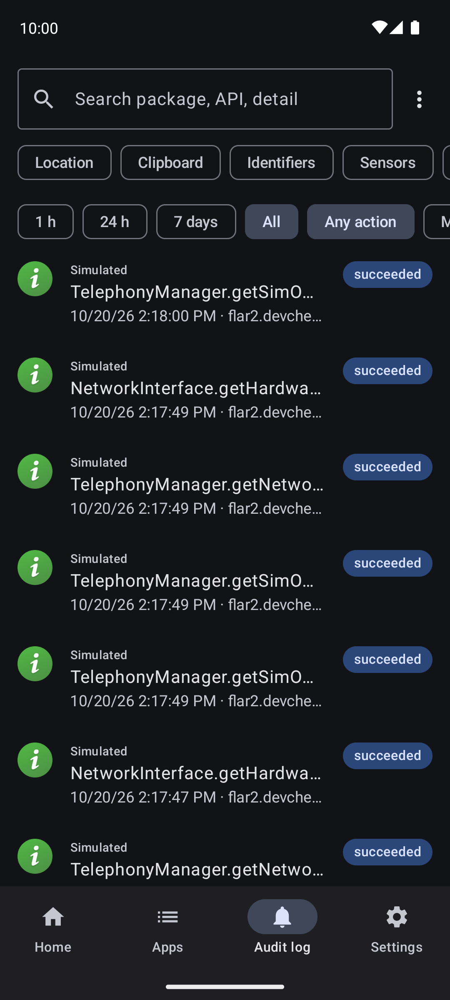
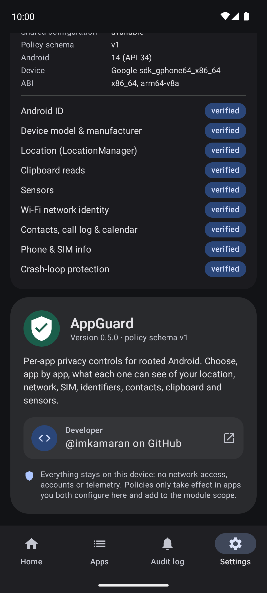

# AppGuard

An LSPosed/Xposed module that controls, per app, how selected privacy-sensitive Android APIs behave
inside that app's process, with a local audit log. Target APKs are not modified.

**Status (v0.5.0):** every listed feature is verified on a device runtime. The companion app has
templates, bulk actions, backup/restore, a 7-day privacy report, access notifications, a Quick
Settings kill switch, and light/dark/system themes with optional dynamic color.

| Feature | State | Details |
|---|---|---|
| Android ID (Simulate) | Verified | [Verification](docs/VERIFICATION.md) |
| Device model/manufacturer (Simulate) | Verified | |
| Location via `LocationManager` (Restrict / Simulate) | Verified | Play services fused location is **not** covered |
| Wi-Fi network identity (Restrict / Simulate) | Verified | SSID, BSSID, MAC, local IP, nearby-network scans |
| Contacts, call log & calendar (Restrict per source) | Verified | Queries return no rows; columns are kept so apps don't crash |
| Phone & SIM info (Restrict / Simulate carrier) | Verified | Operator, country, phone number, carrier id, subscriptions |
| Audit log (local, filterable, JSON/CSV export) | Verified | |
| Clipboard reads (Restrict) | Verified | Writes and keyboard paste are never affected |
| Sensors (Audit only / Restrict by group) | Verified | Motion, compass, environment, activity, body groups |
| Crash-loop protection | Verified | Suspends a policy after 3 start-up crashes |

## Screenshots

<table>
  <tr>
    <td align="center"><br><sub>Home</sub></td>
    <td align="center"><br><sub>Apps</sub></td>
    <td align="center"><br><sub>Policy editor</sub></td>
  </tr>
  <tr>
    <td align="center"><br><sub>Network &amp; SIM controls</sub></td>
    <td align="center"><br><sub>Audit log</sub></td>
    <td align="center"><br><sub>Diagnostics &amp; About</sub></td>
  </tr>
</table>

See [docs/LIMITATIONS.md](docs/LIMITATIONS.md) before relying on any control, and
[docs/COMPATIBILITY.md](docs/COMPATIBILITY.md) for tested environments.

## How it works

```
 ┌──────────────── AppGuard app (companion) ────────────────┐
 │ UI (Compose M3) → PolicyRepository                         │
 │   files/config.json  (canonical, private, atomic writes)   │
 │   └─publish─► "policies" prefs (MODE_WORLD_READABLE →      │
 │               LSPosed/Vector stores it under /data/misc,   │
 │               readable only by processes in module scope)  │
 │ AuditProvider ◄── ContentResolver.call("append") ─────────┐│
 │   (caller authenticated by binder uid; SQLite, bounded)   ││
 └────────────────────────────────────────────────────────────┘│
 ┌──────── target app process (in module scope) ─────────┐    │
 │ XposedEntry → RemotePolicySource (XSharedPreferences,  │    │
 │   reads only p:<own package>, re-checks every 2 s)     │    │
 │ → PolicyResolver (pure, from :policy)                  │    │
 │ → IdentifierHooks / LocationHooks (GuardedHook base)   │    │
 │ → AuditClient (non-blocking, coalescing, batched) ─────┼────┘
 └────────────────────────────────────────────────────────┘
```

Project layout:

| Module | Contents |
|---|---|
| `:policy` (JVM) | Policy models, resolution, validation, schema/codec, synthetic identifiers, location validation, sensor groups, carrier profiles, templates, backup codec, audit model, redaction, CSV/JSON export, feature registry. 75 unit tests. |
| `:app` | `hook/` LSPosed runtime · `config/` config bridge · `audit/` audit service · `apps/` app enumeration · `ui/` Compose screens |
| `:testapp` | Probe app (flavors `target` and `control`) that calls every intercepted API and logs `AGProbe:` lines |
| `tools/verify` | Scripts used for on-device verification |

Key design rules, enforced in code:

- **Nothing is hooked** in a scoped app unless its own package has an enabled, valid policy when the process starts.
- A process only ever decodes the record keyed by its own package, and a record whose embedded package name differs is rejected.
- Every hook is wrapped by `GuardedHook`. Exceptions, missing or corrupt config, or an unsupported schema all **fail open**: the original behavior is kept.
- Hooks never deliver app callbacks from inside a hook, so app code that calls location APIs from a callback is still intercepted.
- System and emergency components (`android`, phone, telecom, SystemUI, Settings, Play services, …) can never receive a policy.
- An audit event says SUCCEEDED only when the hook itself produced the value the app received, or read back the change it made.

## Requirements

- Rooted Android 10+ (tested on Android 14) with Magisk or KernelSU.
- LSPosed, or a fork such as Vector, with **Xposed API ≥ 93**, because the module uses LSPosed's new `XSharedPreferences`.

## Install and configure

1. Download the APK from [Releases](https://github.com/imkamaran/AppGuard/releases), or build it (see below).
2. Install it: `adb install -r AppGuard-<version>.apk`.
3. In the LSPosed/Vector manager, enable **AppGuard**. Add to its scope **AppGuard itself** (used to detect activation) and each app you want to control.
   - With Vector's CLI: `su -c '/data/adb/lspd/cli modules enable io.github.imkamaran.appguard'` and `su -c '/data/adb/lspd/cli scope set io.github.imkamaran.appguard io.github.imkamaran.appguard/0 com.example.target/0'`.
4. Force-stop and open AppGuard. Home should show *Hook runtime loaded* and *Configuration shared*.
5. Open **Apps**, pick an app and switch on **Apply policy to this app**, then choose modes per category.
6. Force-stop the target app (the editor has a root button for this) and start it again. Its page should then show *Last start reported …* and per-feature *Hooks installed*.

Changes to Allow/Restrict/Simulate, location coordinates, the Android ID, the kill switch and audit settings reach running apps within about 2 seconds. Device-info simulation applies at the next app start.

## Build

```sh
# JDK 17+ (Android Studio's bundled JBR 21 works). Set sdk.dir in local.properties.
./gradlew :policy:test                 # unit tests (JVM)
./gradlew :app:assembleRelease         # module APK
./gradlew :testapp:assembleDebug       # probe APKs: target + control flavors
```

Release builds are signed with the key named in a root `keystore.properties`
(`storeFile`, `storePassword`, `keyAlias`, `keyPassword`; never committed). Without that file
they fall back to your local debug key, which cannot update the published APK.

Toolchain: Gradle 9.4.1, AGP 9.2.1 (built-in Kotlin 2.2.10), compileSdk 36, minSdk 29,
targetSdk 34, Compose BOM 2025.08.00, kotlinx-serialization 1.9.0, Xposed API 82 (compileOnly).
All versions are pinned in `gradle/libs.versions.toml`.

## Troubleshooting

| Symptom | Cause / fix |
|---|---|
| Home: *Hook runtime not detected* | Module not enabled, or AppGuard not in its own scope; force-stop AppGuard after enabling. |
| Policy page: *No report from this app yet* | App not in module scope, or not restarted since the policy was enabled. |
| Framework log: `cannot read …policies.xml` | Open AppGuard once while the module is active so it publishes the configuration. |
| Framework log: `no policy applied …: corrupt policy record / unsupported schema N` | Stored data is invalid or newer than the module; the app runs unmodified. Re-save the policy in AppGuard or update the module. |
| Framework log: `cannot deliver audit events … Unknown authority` | AppGuard was not visible to the app (Android 11+ package visibility). Open AppGuard once; it renews visibility grants on each start and after boot. |
| An app misbehaves | Switch its policy off, or use the kill switch on Home. As a last resort, disable the module in the manager. |
| Policy page: *CRASH_GUARD … policy suspended* | The app crashed 3 times right after start with this policy. Change or re-save the policy to try again. |

Framework logs: Vector `su -c '/data/adb/lspd/cli log cat'`; LSPosed: manager → Logs. Lines start with `AppGuard:`.

## Privacy of AppGuard itself

No network permission, accounts or telemetry. Audit events are stored only in AppGuard's private database, with bounded retention (age and count). Clipboard contents and real identifiers are never logged. Synthetic values and coordinates (rounded to about 1 km) appear in event details only when redaction is turned off.

## Author

Built by [@imkamaran](https://github.com/imkamaran) on GitHub.

## License

[GPL-3.0](LICENSE). AppGuard is free software: you can redistribute it and/or modify it under the
terms of the GNU General Public License, version 3 or later.
